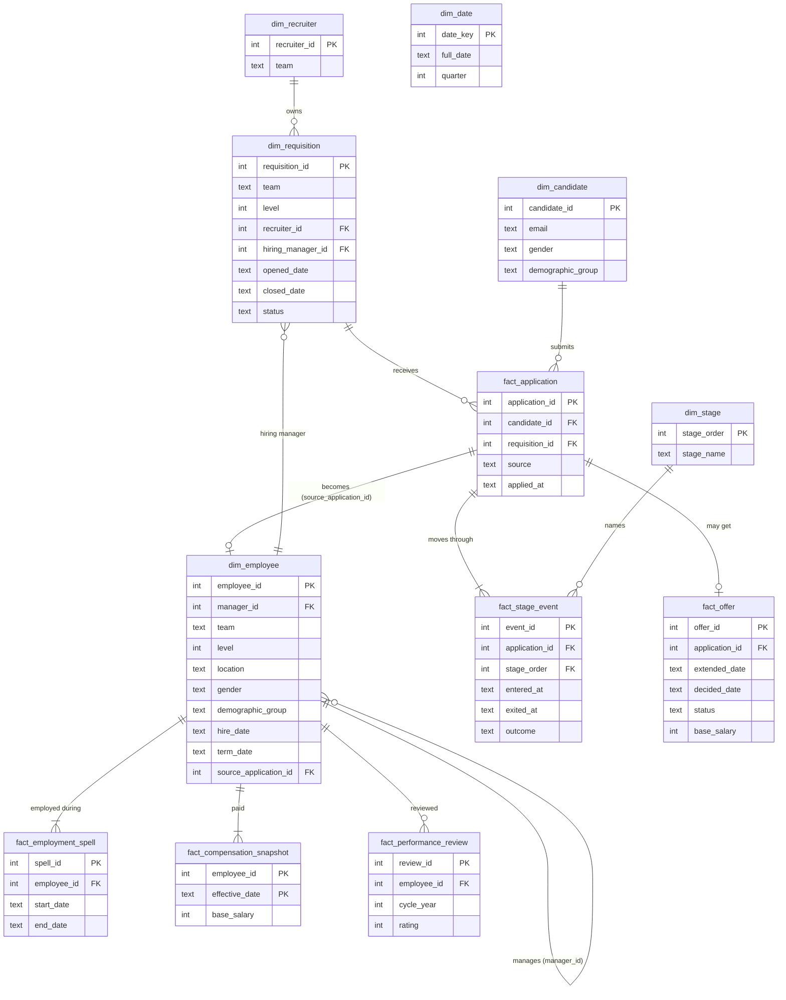

# talent-analytics-sql

A People and Talent analytics warehouse written in SQL. It models hiring (requisitions, applications, stage-by-stage
pipeline events, offers) and the workforce (employees, org tree, pay, performance reviews), generates reproducible
synthetic data for a fictional company, and answers 28 business questions with documented queries. Every analytic query
is tested against an independent Python re-computation of the same answer.

It runs on the Python standard library only (SQLite), with nothing to install.

**What it demonstrates:** schema design with constraints, CTEs, recursive CTEs (date spine, org tree, subtree roll-up,
cycle protection), window functions (`RANK`, `DENSE_RANK`, `NTILE`, `LAG`, `LEAD`, `PERCENT_RANK`, running totals, moving
averages), percentiles without a percentile function, conditional aggregation, cohort and funnel analysis, gaps and
islands, small-cell suppression, a four-fifths adverse-impact check, data-quality checks, indexes and query plans, and
differential testing.

All data is synthetic. The company, people and e-mail addresses (`@example.test`) are invented.

## Quickstart (about 60 seconds)

```text
python -m talentsql seed                  # build var/talent.db: 2,000 employees, 100,000 applications (about 7 seconds)
python -m talentsql list                  # the numbered queries
python -m talentsql run 3                 # run query 3 and print a table
python -m talentsql explain 9             # EXPLAIN QUERY PLAN for query 9
python -m talentsql bench                 # time the slowest queries without and with indexes
python -m talentsql report                # write docs/SAMPLE_REPORT.md from the real query output
python -m unittest discover -s tests -t . # 83 tests
```

Run commands from the repository root. Needs Python 3.11 or newer and SQLite 3.35 or newer (the copy bundled with Python
does). Options: `python -m talentsql seed --employees 500 --applications 20000 --seed 7`, `run 9 --all` for every row.

**Finding Python on Windows.** If `python` is not recognised, Python is installed but not on your `PATH`. Try the launcher
(`py -3 -m talentsql seed`), or call the interpreter by its full path:

```text
"%LOCALAPPDATA%\Programs\Python\Python313\python.exe" -m talentsql seed
```

In PowerShell: `& "$env:LOCALAPPDATA\Programs\Python\Python313\python.exe" -m talentsql seed`. The folder name depends on
the version you installed; `<you>` stands for your own Windows user folder if you prefer to write the path out. Running
`where.exe python` and `py -0` show what is available.

## Data model



Notes on the model:

- Dates are ISO-8601 text (`YYYY-MM-DD`) and join to `dim_date.full_date`. A `meta` table holds the **as-of date**
  (`2025-12-31` for generated data), so queries about "now" are repeatable instead of depending on the clock.
- `fact_stage_event` has one row per stage an application entered. `outcome = 'open'` means it is still there.
- `dim_employee` holds everyone who was ever employed; `term_date IS NULL` means current. `hire_date` and `term_date`
  span the first hire to the final exit; `fact_employment_spell` records the exact periods, so leaves and re-hires are visible.
- Constraints encode single-row rules (status and dates must agree, ratings 1 to 5, no self-management, stage name must
  match stage number). Rules that span rows are checked by query 21.
- Secondary indexes live in `sql/indexes.sql` so the benchmark can drop and re-create them.

## Query catalogue

Each file in `sql/queries/` opens with a comment block: business question, tables used, technique, edge cases. How each
technique works, with the exact SQL, is in [docs/QUERY_GUIDE.md](docs/QUERY_GUIDE.md).

| # | Query | Business question | Technique |
|---|---|---|---|
| 01 | [Hiring funnel by stage](sql/queries/01_funnel_by_stage.sql) | How many applications reach each stage and what share survives each step? | `LAG`, `FIRST_VALUE`, `NULLIF` |
| 02 | [Funnel by source](sql/queries/02_funnel_by_source.sql) | Which channels turn applications into hires, and where does each lose people? | conditional aggregation (pivot) |
| 03 | [Time to hire p50/p90](sql/queries/03_time_to_hire_percentiles.sql) | How long does a typical hire take, and how long is the slow tail? | nearest-rank percentiles with `ROW_NUMBER` |
| 04 | [Offer acceptance by team](sql/queries/04_offer_acceptance_by_team.sql) | What share of decided offers does each team win, and is the sample big enough? | Wilson confidence interval in SQL |
| 05 | [Recruiter productivity ranking](sql/queries/05_recruiter_productivity_rank.sql) | Who closes the most hires, and how do ties rank? | `RANK`, `DENSE_RANK`, `NTILE` |
| 06 | [Requisition ageing](sql/queries/06_requisition_ageing.sql) | How old are open requisitions, by team? | `CASE` bucketing |
| 07 | [Headcount over time](sql/queries/07_headcount_over_time.sql) | How did headcount and trailing attrition move month by month? | recursive date spine, running totals |
| 08 | [Attrition by hire cohort](sql/queries/08_attrition_by_hire_cohort.sql) | How many of each year's hires left, and how long did leavers stay? | cohort grouping |
| 09 | [Org tree](sql/queries/09_org_tree_recursive.sql) | What does the reporting structure look like, and how deep is everyone? | recursive CTE with path and cycle guard |
| 10 | [Subtree headcount rollup](sql/queries/10_org_subtree_rollup.sql) | How big is each manager's whole organisation? | recursive closure, `GROUP BY` ancestor |
| 11 | [Span of control](sql/queries/11_span_of_control.sql) | How many direct reports do managers carry at each level? | two-step aggregation |
| 12 | [Hiring quality by source](sql/queries/12_hiring_quality_by_source.sql) | Do some channels bring people who perform better and stay longer? | join back to the hiring application |
| 13 | [Pay-equity gap by level](sql/queries/13_pay_equity_gap_by_level.sql) | How does average pay compare for women and men, without publishing small cells? | latest-row-per-key, k-anonymity (n >= 5) |
| 14 | [Four-fifths adverse-impact check](sql/queries/14_adverse_impact_four_fifths.sql) | Is any group advanced at under 80% of the best group's rate? | `MAX() OVER (PARTITION BY ...)` |
| 15 | [Continuous employment](sql/queries/15_continuous_employment_islands.sql) | What are the unbroken runs of employment, allowing 31-day breaks? | gaps and islands |
| 16 | [Stage dwell times](sql/queries/16_stage_dwell_times_lag_lead.sql) | How long do candidates sit in a stage and wait between stages? | `LAG` / `LEAD` |
| 17 | [Hires by team and quarter](sql/queries/17_hires_pivot_by_team_quarter.sql) | When in the year does each team hire? | pivot with `dim_date` |
| 18 | [Top 3 sources per team](sql/queries/18_top_sources_per_team.sql) | Which three channels produce each team's hires? | top-N per group with `ROW_NUMBER` |
| 19 | [Application volume trend](sql/queries/19_application_volume_moving_average.sql) | Is volume rising once monthly noise is smoothed? | moving average, `LAG(n, 12)` |
| 20 | [Duplicate candidates](sql/queries/20_duplicate_candidate_detection.sql) | Who was entered twice, and did they apply twice to one requisition? | normalised key, `HAVING COUNT(*) > 1` |
| 21 | [Data-quality checks](sql/queries/21_data_quality_checks.sql) | Does the data obey the rules constraints cannot express? | `UNION ALL` of checks, recursive loop detection |
| 22 | [Application seasonality](sql/queries/22_application_seasonality.sql) | Which calendar months are busy? | two-level aggregation, `AVG() OVER ()` |
| 23 | [Requisition outcomes](sql/queries/23_requisition_outcomes_by_team.sql) | What share of closed requisitions are filled, and how fast? | conditional aggregation |
| 24 | [Cohort retention matrix](sql/queries/24_cohort_retention_matrix.sql) | What share of each hire quarter is still employed at 3 to 24 months? | cohort analysis with eligibility |
| 25 | [Compa-ratio outliers](sql/queries/25_compa_ratio_outliers.sql) | Who is paid far from their peers? | `AVG() OVER`, `PERCENT_RANK` |
| 26 | [Rejection Pareto](sql/queries/26_rejection_pareto.sql) | Which stages account for most rejections? | cumulative `SUM() OVER` |
| 27 | [Open pipeline snapshot](sql/queries/27_open_pipeline_snapshot.sql) | Who is waiting in each stage right now, and for how long? | as-of filtering, `LEFT JOIN` from a dimension |
| 28 | [Manager attrition and ratings](sql/queries/28_manager_attrition_and_ratings.sql) | Which managers lose people faster than the company? | roll-up with `HAVING`, benchmark join |

## Sample output

Real output from `python -m talentsql run 1` on the generated data (seed 42):

```text
stage_order  stage_name                applications_reached  pct_of_applied  pct_of_previous_stage
-----------  ------------------------  --------------------  --------------  ---------------------
          1  Applied                                 100000          100.00                   NULL
          2  Recruiter Screen                         26692           26.69                  26.69
          3  Hiring Manager Screen                    14244           14.24                  53.36
          4  Onsite                                    7170            7.17                  50.34
          5  Offer                                     1722            1.72                  24.02
          6  Offer Accepted                            1235            1.24                  71.72
```

`python -m talentsql run 3` (nearest-rank percentiles, days from application to accepted offer):

```text
team          hires  p50_days  p90_days  mean_days  max_days
------------  -----  --------  --------  ---------  --------
ALL            1235        34        45      34.95        74
Engineering     364        34        44      35.03        74
Sales           221        34        44      34.48        68
Support         182        35        48      36.01        63
Product          90        35        47      36.33        63
```

The generated data contains a deliberate screening bias against one group so query 14 has something to find. It flags group
G3 at the recruiter screen (selection rate 45.48% against a best rate of 60.03%, impact ratio 0.76). The full output of
every query is in [docs/SAMPLE_REPORT.md](docs/SAMPLE_REPORT.md).

## Tests

`python -m unittest discover -s tests -t .` runs 83 tests in about 8 seconds.

- **Differential tests (28).** For each analytic query, `tests/oracles.py` recomputes the expected answer in plain Python from the
  raw table rows (dictionaries and loops, no SQL), and the test asserts the SQL result matches. Each runs on two databases: a
  small deterministic fixture (`tests/fixture.py`) built to hit the edge cases (a tie in recruiter hires, a recruiter with no
  hires, a departed manager, spells with gaps of 31 and 32 days, duplicate candidates) and a database made by the real generator.
- **Hand-checked scenarios** with literal expected values: percentile positions for 7 and 10 values, a suppression cell of
  exactly 5 against 4, the four-fifths ratio at exactly 0.80, island boundaries, and the retention checkpoint day.
- **Constraints:** a bad foreign key, a duplicate application, a stage name that does not match its number, offer and
  requisition state rules, and self-management are all rejected.
- **Recursive org tree** terminates on a reporting loop, and the rollup still matches the oracle on loop data.
- **Seeding** is idempotent: the same arguments give identical table contents, re-seeding does not duplicate rows, and the
  seeder refuses to overwrite a database it did not create.
- **Data quality:** all 16 checks pass on generated data; injected defects are detected and counted the same way as by an
  independent Python check.
- **CLI and benchmark** smoke tests.

I also checked that the tests can fail: ten one-line mutations of the SQL (a changed percentile rank, `<` to `<=` in the
four-fifths rule, a different suppression threshold, a 31 to 32 day island rule, and others) each made the suite fail.

## Performance

Measured by `python -m talentsql bench --write` with 100,000 applications, 149,828 stage events, 2,000 employees.
Machine: AMD Ryzen 5 PRO 8540U, 12 logical cores, 31.3 GB RAM, Windows 11, Python 3.13.5, SQLite 3.49.1. Median of 5 runs
after a warm-up. "No indexes" means the secondary indexes in `sql/indexes.sql` are dropped (primary keys and UNIQUE
constraints remain).

| # | Query | No indexes (ms) | With indexes (ms) | Speed-up |
|---|---|---|---|---|
| 21 | Data-quality checks | 2075.8 | 401.7 | 5.17x |
| 16 | Stage dwell times (LAG / LEAD) | 1051.1 | 885.5 | 1.19x |
| 14 | Four-fifths adverse-impact check | 641.5 | 588.0 | 1.09x |
| 20 | Duplicate candidate detection | 324.5 | 191.1 | 1.70x |
| 02 | Funnel by source | 208.0 | 214.5 | 0.97x |
| 26 | Rejection Pareto | 149.3 | 35.6 | 4.19x |
| 22 | Application seasonality | 133.3 | 82.7 | 1.61x |
| 19 | Application volume trend | 102.4 | 45.9 | 2.23x |
| 01 | Funnel by stage | 64.4 | 12.7 | 5.06x |
| 27 | Open pipeline snapshot | 28.4 | 0.6 | 45.39x |

Seven of ten improved by 1.2x or more. The others are within noise (query 2, 0.97x) or gained little (queries 14 and 16, 1.09x and
1.19x); both read most of the stage-event table either way. Timings move by tens of percent between runs, so treat small differences as noise. The
`EXPLAIN QUERY PLAN` output for each query, scan versus index search, is in [docs/PERFORMANCE.md](docs/PERFORMANCE.md).

## Porting to PostgreSQL / Redshift / BigQuery

**This project was written and run on SQLite only (3.49.1).** The notes below are the dialect differences for the features
the queries use; they are from knowledge of those systems and have not been executed against them.

| Feature (queries) | SQLite (here) | PostgreSQL | Redshift | BigQuery |
|---|---|---|---|---|
| Days between dates (3, 6, 8, 16, 23) | `julianday(a) - julianday(b)` | `a - b` on `date` columns | `DATEDIFF(day, b, a)` | `DATE_DIFF(a, b, DAY)` |
| Add or subtract time (7, 12, 24) | `date(x, '+1 month')`, `date(x, '-365 days')` | `x + INTERVAL '1 month'`, `x - 365` | `DATEADD(month, 1, x)` | `DATE_ADD(x, INTERVAL 1 MONTH)`, `DATE_SUB(...)` |
| First of month (7, 19) | `date(x, 'start of month')` | `DATE_TRUNC('month', x)` | `DATE_TRUNC('month', x)` | `DATE_TRUNC(x, MONTH)` |
| Format a date (7, 19, 22) | `strftime('%Y-%m', x)` | `TO_CHAR(x, 'YYYY-MM')` | `TO_CHAR(x, 'YYYY-MM')` | `FORMAT_DATE('%Y-%m', x)` |
| Percentile (3) | nearest rank by `ROW_NUMBER` (portable) | `PERCENTILE_DISC(0.9) WITHIN GROUP (ORDER BY d)` | same `WITHIN GROUP` syntax | `PERCENTILE_DISC(d, 0.9) OVER (...)` or `APPROX_QUANTILES` |
| Date spine (7) | recursive CTE | `generate_series(start, end, interval '1 month')` | recursive CTE (keep it, or use a numbers/calendar table) | `UNNEST(GENERATE_DATE_ARRAY(start, end, INTERVAL 1 MONTH))` |
| Recursive CTE (9, 10, 21) | `WITH RECURSIVE` | `WITH RECURSIVE`; version 14 adds a `CYCLE` clause | `WITH RECURSIVE` | `WITH RECURSIVE` (iteration limit applies) |
| Substring position (20) | `instr(s, '+')` | `POSITION('+' IN s)` or `STRPOS` | `POSITION` or `STRPOS` | `INSTR(s, '+')` or `STRPOS` |
| Outline indent (9) | `replace(hex(zeroblob(n)), '00', '  ')` | `REPEAT('  ', n)` | `REPEAT('  ', n)` | `REPEAT('  ', n)` |
| Top-N filter (18) | window in a CTE, filter outside | same, or `DISTINCT ON` | same | same, or `QUALIFY` |
| `QUALIFY` | not supported (not used here) | not supported | check your version's documentation | supported |
| Integer division (3) | `(50 * n + 99) / 100` is integer | same | same | `/` returns FLOAT; use `DIV(a, b)` |
| `ROUND(x, 2)` on float (most) | works on floating point | needs `numeric`: `ROUND(x::numeric, 2)` | works | works |
| Text and number concatenation (13) | `'<' \|\| 5` coerces | `'<' \|\| CAST(5 AS TEXT)` | same | `CONCAT('<', CAST(5 AS STRING))` |
| `AS MATERIALIZED` (19) | supported (3.35+) | supported (12+) | remove it | remove it |
| `SQRT` (4) | needs SQLite 3.35 built with math functions (the runner adds a fallback if missing) | standard | standard | `SQRT` |
| Dates as `TEXT` | ISO strings compare correctly | use `DATE` columns | use `DATE` columns | use `DATE` columns |
| Constraints and foreign keys | enforced (with `PRAGMA foreign_keys = ON`) | enforced | informational only, not enforced | informational only, not enforced |
| Auto keys, loading | explicit ids, `executemany` | `GENERATED ... AS IDENTITY`, `COPY` | `COPY` from S3 | load jobs |

Window functions (`RANK`, `DENSE_RANK`, `NTILE`, `LAG`, `LEAD`, `FIRST_VALUE`, `PERCENT_RANK`, `SUM() OVER`) and
`ROWS BETWEEN` frames use standard syntax in all four. Because Redshift and BigQuery do not enforce keys, the data-quality
queries in this repo (21) would be even more important there, and the constraint tests would not carry over.

## Limitations

- **Synthetic data.** The distributions were chosen to look plausible; they are not calibrated to any real company. Findings
  such as the screening bias and pay gap are built in so the queries have something to detect.
- **Pay gap is unadjusted.** Query 13 compares average pay by level only. It does not control for team, location, tenure or
  role, so it is a screening number, not an equity analysis.
- **Four-fifths rule is a heuristic.** Query 14 flags ratios under 0.80 and ignores groups with under 10 decisions. A flag
  prompts investigation; it does not establish discrimination.
- **Manager is current, not historical.** `dim_employee.manager_id` is the last known manager. There is no history table, so
  org queries describe the present, and attrition by manager attributes past leavers to their last manager.
- **Day-level dates.** Events have dates, not timestamps.
- **One seat per requisition.** Each requisition is filled by at most one hire.
- **Percentile method.** Query 3 uses nearest rank, which can differ slightly from interpolated percentiles in other tools.
- **Runs on SQLite only.** Window functions and `MATERIALIZED` need SQLite 3.35 or newer; `SQRT` needs math functions
  (added automatically if the build lacks them). The test suite was run on Python 3.13; the CI workflow runs it on 3.11,
  3.12 and 3.13.
- **Benchmarks are from one machine,** single process, with noise of tens of percent on small queries.
- **Run from the repository root.** The package reads `sql/` relative to its own location and is not a distributable library.

## Repository layout

See [CODE_MAP.md](CODE_MAP.md) for one line per file.

## License

MIT. See [LICENSE](LICENSE). Copyright (c) 2026 Money Chanalia.
